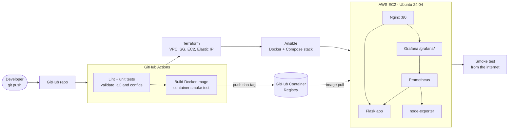

# AutoDeploy: End-to-End DevOps Automation Platform

One `git push` takes code from your laptop to a secure, containerised and monitored application on AWS, with no manual server access.

> project by **Sonal Kumar**.
> This repository is the working implementation of the *AutoDeploy* project synopsis.



## What you get

| Layer | Tool | Where in this repo |
|---|---|---|
| Sample web app (the deployment payload) | Python / Flask / Gunicorn | [`app/`](app) |
| Containerisation | Docker + Docker Compose | [`app/Dockerfile`](app/Dockerfile), [`docker-compose.yml`](docker-compose.yml) |
| CI/CD orchestration | GitHub Actions | [`.github/workflows/`](.github/workflows) |
| Image registry | GitHub Container Registry (GHCR) | pushed by `ci-cd.yml` |
| Infrastructure as Code | Terraform (AWS VPC, subnet, security group, EC2, Elastic IP) | [`terraform/`](terraform) |
| Configuration management & deployment | Ansible (3 roles) | [`ansible/`](ansible) |
| Reverse proxy | Nginx | [`nginx/default.conf`](nginx/default.conf) |
| Monitoring & dashboards | Prometheus + Grafana + node-exporter | [`monitoring/`](monitoring) |

Beyond the synopsis, the pipeline also includes: post-deploy smoke tests, one-click rollback, a destroy workflow, alert rules with unit tests, Dependabot, and a script that configures all GitHub secrets for you.

## Quick start A: run everything locally (no AWS needed)

Requires Docker Desktop (or Docker Engine) with Compose.

```bash
cp .env.example .env          # local settings (Nginx on port 8080)
docker compose up -d --build  # app + Nginx + Prometheus + Grafana + node-exporter
```

| What | URL |
|---|---|
| Application status page | <http://localhost:8080> |
| Grafana dashboards | <http://localhost:8080/grafana/> (login `admin` / `admin`, from `.env`) |
| Prometheus | <http://localhost:9090> |

Fill the dashboards with sample traffic, then explore the **AutoDeploy - Overview** dashboard:

```bash
scripts/load-test.sh http://localhost:8080 60
```

Stop with `docker compose down`. (`make up`, `make down`, `make help` do the same if you have `make`.)

## Quick start B: deploy to AWS with a git push

Full walkthrough with screenshots-in-words and troubleshooting: **[docs/DEPLOYMENT_GUIDE.md](docs/DEPLOYMENT_GUIDE.md)**. The short version:

1. Push this repository to your own GitHub account (branch `main`).
2. Create an AWS access key for a deployment user and a state bucket: `scripts/bootstrap-backend.sh`.
3. Run `scripts/setup-github.sh`. It generates an SSH key and stores every secret and variable in your repository.
4. Push to `main` (or run the **CI/CD** workflow). Watch **Actions**: tests, build, Terraform, Ansible, smoke test.
5. Open the URLs printed in the run summary.

Until you set the repository variable `DEPLOY_TO_AWS=true` (done by `setup-github.sh`), the pipeline runs the CI and image-publishing stages only and stays green, so you can push safely before AWS is configured.

## How the pipeline works

| Stage | Job | What happens |
|---|---|---|
| 1 | `test` | flake8 + pytest with coverage |
| 2 | `validate-infra` | `terraform fmt/validate`, `ansible-lint`, `yamllint`, `shellcheck`, `hadolint`, `nginx -t`, Compose validation, Prometheus config + alert-rule unit tests |
| 3 | `build` | Build the image, **run it and probe `/health`**, confirm it is not root, then push `ghcr.io/<owner>/<repo>:sha-<commit>` |
| 4 | `provision` | Terraform plan + apply against remote state in S3 (idempotent: later runs change nothing unless the code changed) |
| 5 | `configure` | Ansible installs Docker, copies the stack, pulls the image, starts it, then verifies health, version, Grafana, Prometheus targets, and that `/metrics` is not public |
| 6 | `verify` | An independent smoke test from the internet, expecting the exact version that was just deployed |

Pull requests run stages 1-3 without pushing anything. Deployment only happens from `main`.

## Repository layout

```
.
├── app/                      Flask demo app, tests, Dockerfile
├── docker-compose.yml        The runtime stack (identical locally and on AWS)
├── docker-compose.override.yml   Local-only: builds the image from source
├── nginx/default.conf        Reverse proxy, rate limiting, blocked /metrics
├── monitoring/
│   ├── prometheus/           scrape config, alert rules, alert unit tests
│   └── grafana/              provisioned datasource + "AutoDeploy - Overview" dashboard
├── terraform/                VPC, subnet, IGW, security group, EC2, Elastic IP
├── ansible/                  site.yml + roles: common, docker, app
├── scripts/                  smoke test, load test, key / bucket / GitHub setup
├── .github/workflows/        ci-cd, deploy (reusable), rollback, destroy
├── docs/                     deployment guide, architecture
└── Makefile                  shortcuts (make help)
```

## Everyday operations

| Task | How |
|---|---|
| Release a change | Commit and push to `main`. |
| Roll back | Actions → **Redeploy / Rollback** → enter an earlier tag such as `sha-1a2b3c4`. |
| See what is deployed | The version badge on the status page, or the *Deployed version* panel in Grafana. |
| Open Prometheus on the server | `make tunnel IP=<server-ip>` then <http://localhost:9090> (it is not exposed publicly). |
| SSH to the server | `make ssh IP=<server-ip>` (output also shown by `terraform output ssh_command`). |
| Stop AWS charges | Actions → **Destroy infrastructure** → type `destroy`. |

## Security design

* The only ports open on the server are **22** (SSH, key-only) and **80** (Nginx). Prometheus listens on `127.0.0.1`; Grafana, the app and node-exporter are reachable only through Nginx or the Docker network.
* Raw `/metrics` endpoints are blocked at Nginx, and the pipeline fails if they ever become public.
* App container: non-root user, read-only filesystem, all Linux capabilities dropped, `no-new-privileges`.
* EC2: encrypted gp3 volume, IMDSv2 required (hop limit 1, so containers cannot read instance metadata).
* Secrets live only in GitHub Actions secrets. Ansible receives them as environment variables (never on a command line), writes the `.env` as `0600`, and logs out of GHCR when finished.
* Terraform state is in a private, versioned, encrypted S3 bucket with native state locking.
* SSH is open to the world by default because GitHub-hosted runners have changing IPs. Restrict it with the `ALLOWED_SSH_CIDRS` repository variable if you deploy from a fixed address (see the guide).
* HTTPS is not enabled by default (there is no domain name to issue a certificate for). Add a domain and Let's Encrypt as a next step; see *Future enhancements*.

## Cost

Everything runs on one EC2 instance (default `t3.small`) with a 20 GB volume and an Elastic IP. AWS bills public IPv4 addresses, so leaving it running costs real money: check the current [EC2 pricing](https://aws.amazon.com/ec2/pricing/on-demand/) for your region. **Run the Destroy workflow when you are not demoing.** `EC2_INSTANCE_TYPE=t3.micro` also works (Ansible adds a swap file) but is slower.

## Mapping to the synopsis

| Synopsis objective | Implementation |
|---|---|
| Automated CI/CD with GitHub Actions: integration, testing, continuous delivery | `.github/workflows/ci-cd.yml`, `deploy.yml` |
| Docker to standardise dev, test and production environments | `app/Dockerfile`, one `docker-compose.yml` used locally and on AWS |
| Terraform for dynamic provisioning of EC2 and network components | `terraform/` (VPC, subnet, IGW, routes, security group, EC2, Elastic IP, S3 remote state) |
| Ansible playbooks for server configuration and deployment | `ansible/` (`common`, `docker`, `app` roles, with built-in verification) |
| Prometheus and Grafana for health monitoring | `monitoring/`, `node-exporter`, provisioned dashboard and 6 alert rules |
| Nginx as reverse proxy | `nginx/default.conf` |
| Expected result: one push gives a monitored, containerised app with no terminal access | Demonstrated by the pipeline; verified by the `verify` job |
| Foundation for blue-green / canary | Image tags are immutable (`sha-<commit>`), deploy and rollback share one path |

## Future enhancements (from the synopsis)

* **Security scanning:** add Trivy (images) and SonarQube/CodeQL (source) as extra jobs before `build` publishes.
* **Kubernetes:** replace the Compose step in the `app` role with a cluster deployment.
* **Blue-green / canary:** run two app containers behind Nginx upstreams and switch after the smoke test.
* **Database migrations and automatic rollback:** run migrations as a pre-deploy step; call the rollback workflow when `verify` fails.
* **HTTPS:** register a domain, point it at the Elastic IP, add Certbot to the `app` role and open port 443 in `terraform/main.tf`.
* **Alert delivery:** add Alertmanager and route the existing rules to e-mail or Slack.

## License

MIT, see [LICENSE](LICENSE).
