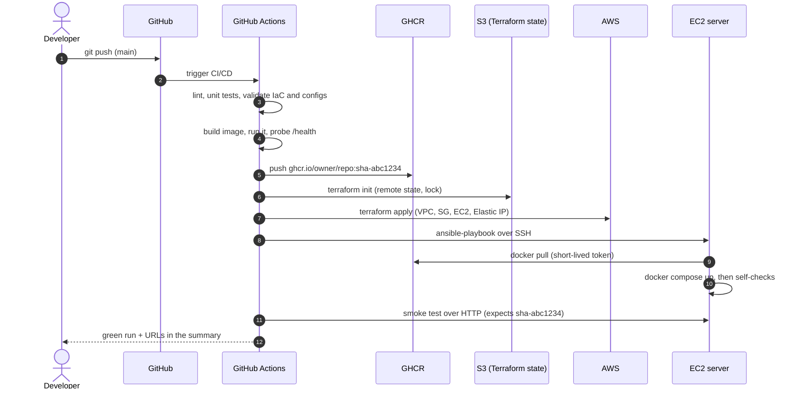
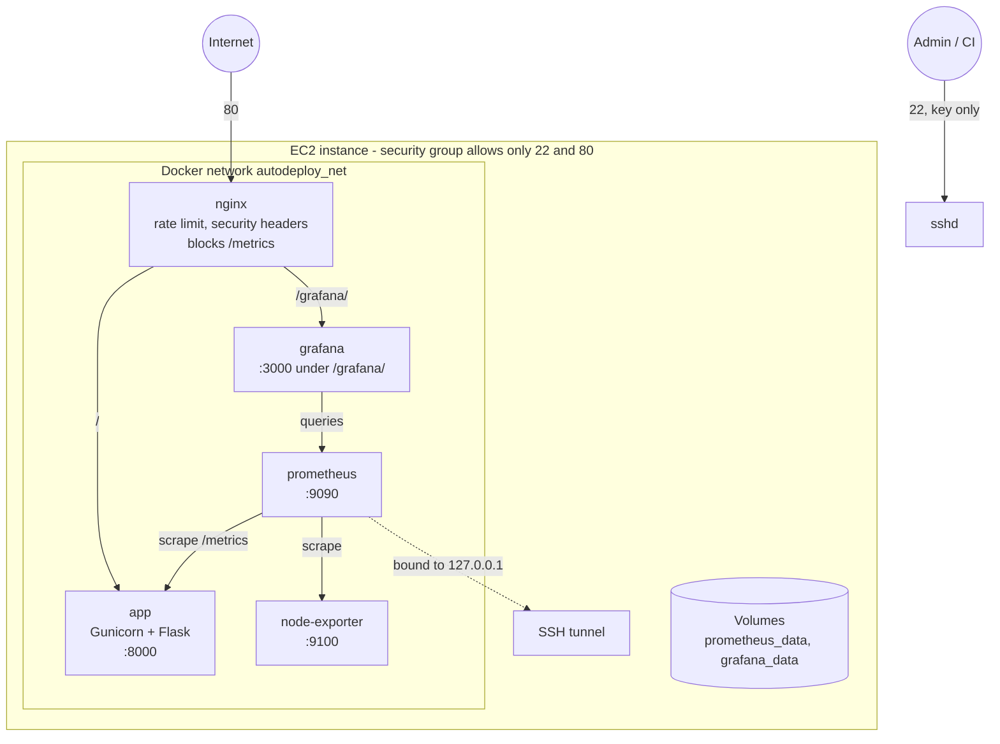

# Architecture

## 1. End-to-end flow

## 2. Runtime topology on the server

Only Nginx is published to the internet. Prometheus is bound to `127.0.0.1` (reach it with an SSH tunnel); Grafana and the app are reachable only through Nginx.

## 3. Repository responsibilities

| Concern | Owner | Notes |
|---|---|---|
| What runs | `docker-compose.yml` + `nginx/` + `monitoring/` | One definition for laptop and server, so "works on my machine" cannot diverge. |
| Where it runs | `terraform/` | Network, firewall, server, stable IP. Knows nothing about the application. |
| How the server is set up and the stack deployed | `ansible/` | Copies the exact files from the repo, writes the environment file, starts the stack, verifies it. |
| When things happen | `.github/workflows/` | Orchestration only; each step calls a tool that can also be run by hand (`make` targets). |

## 4. Design decisions

| Decision | Why |
|---|---|
| **Same compose file everywhere**, with the local-only build in `docker-compose.override.yml` | Ansible copies only `docker-compose.yml`, so the server never builds images and always runs exactly the image CI tested. |
| **Image tag is the commit** (`sha-<7 chars>`), plus `latest` | Immutable, traceable releases. Rollback is "deploy an older tag". The tag is also baked into the app and exposed in `/health` and Prometheus, so every verification step can assert *which* version is live. |
| **Nginx resolves upstreams at request time** (`resolver 127.0.0.11` + variables) | A deployment recreates containers with new IPs. Nginx's default of resolving once at start-up would keep proxying to the dead IP; this also lets Nginx start before Grafana is up. |
| **Grafana served from `/grafana/`** on port 80 | One public port; no extra security-group rules, and works without a domain name. |
| **`/metrics` blocked at Nginx**; Prometheus scrapes inside the Docker network | Metrics reveal internals. A post-deploy check fails the release if `/metrics` is reachable publicly. |
| **Recreate containers when any bind-mounted config changes** (Ansible `recreate: always` on file changes) | Compose cannot see changes inside bind-mounted files, so without this a config change would deploy "successfully" and not take effect. |
| **One Gunicorn worker, four threads** | Prometheus client metrics live in process memory; several worker processes would each report their own partial counters. Threads keep concurrency and correct metrics without multiprocess mode. |
| **Terraform state in S3 with `use_lockfile`** | Pipeline runners are ephemeral, so local state would create a new server every run. Native S3 locking removes the need for a DynamoDB table. |
| **`ignore_changes = [ami]` on the instance** | A newer Ubuntu image being published must never silently replace (and wipe) a running server. Update the OS with `apt`, not by replacement. |
| **Elastic IP** | The public address survives instance replacement, so bookmarks, the Grafana root URL and DNS stay valid. |
| **Pick the Availability Zone from instance-type offerings** | Not every AZ offers every instance type; this avoids a confusing failure in some regions. |
| **GHCR login only for the duration of the deploy**, then `docker logout` | The short-lived token is never left on the server. |
| **Secrets via environment variables** (`lookup('env', ...)`) | Command-line arguments are visible in process lists and logs; environment variables are masked by GitHub and not echoed by Ansible. |
| **`DEPLOY_TO_AWS` switch** | New users can push and see a green CI run before configuring AWS; deployment is an explicit opt-in. |
| **Reusable `deploy.yml`** | Deploy and rollback share one tested path, so a rollback exercises exactly the same steps as a release. |

## 4.1 Deployment strategy

Releases are a **rolling replace of the app container**: Compose recreates it, Nginx re-resolves the new address, and the pipeline verifies the new version before reporting success. A request in flight during the few seconds of replacement can fail. This is the foundation the synopsis calls "zero-downtime potential": because releases are immutable tags behind a reverse proxy, a blue-green or canary step (two app containers, switch Nginx upstream after the health check) is an incremental change to the `app` role rather than a redesign.

## 5. Quality gates (what CI enforces on every push and pull request)

| Gate | Tool |
|---|---|
| Python style | flake8 |
| Application behaviour (15 tests, 100% line coverage) | pytest + pytest-cov |
| Terraform formatting and validity | `terraform fmt -check`, `terraform validate` |
| Ansible correctness and best practice (production profile) | `ansible-playbook --syntax-check`, `ansible-lint` |
| YAML hygiene | yamllint |
| Shell scripts | shellcheck |
| Dockerfile best practice | hadolint |
| Reverse proxy config | `nginx -t` |
| Prometheus config, alert rules and **alert unit tests** | `promtool check config`, `promtool test rules` |
| The built image actually starts, answers `/health` with the right version, and is not root | container smoke test in the `build` job |
| After deploy: health + version, Grafana, Prometheus ready, every scrape target up, `/metrics` not public | Ansible verification tasks, then an independent smoke test from the internet |

## 6. Observability

* **Application metrics** (`http_requests_total`, `http_request_duration_seconds`, in-flight requests, uptime, build info) are exposed by the app at `/metrics`. Endpoint labels use the route template, not the raw URL, so URL scanning cannot create unbounded label cardinality.
* **Host metrics** (CPU, memory, disk, load) come from node-exporter.
* **Dashboard**: *AutoDeploy - Overview* is provisioned automatically (status, deployed version, request rate, error rate, latency percentiles, CPU/memory/disk, load, disk I/O).
* **Alert rules** (`monitoring/prometheus/alerts.yml`, unit-tested in `alerts.test.yml`): target down, high 5xx ratio, high p95 latency, high CPU, high memory, low disk. They are visible in Prometheus and as the *Firing alerts* panel; connecting Alertmanager for e-mail/Slack is listed under future work.

## 7. Known limitations

These are deliberate scope choices for a foundational pipeline, not oversights:

* **Single server, single AZ.** No high availability. A server failure means redeploying (the pipeline does it in one run).
* **Monitoring data lives on the server's disk.** Destroying the infrastructure deletes Prometheus history and Grafana customisations (the provisioned dashboard comes back on the next deploy).
* **No HTTPS.** Traffic to port 80 is unencrypted until you add a domain and certificate.
* **No automatic rollback.** A failed verification fails the run and leaves the broken release running until you use the rollback workflow. Automatic rollback is a listed future enhancement.
* **SSH is open to the internet by default** (key-only) because hosted runners have no fixed IP.
* **Static AWS access keys.** OIDC role assumption is the recommended upgrade (see the deployment guide).
* **Alerts are not delivered anywhere yet** (no Alertmanager).
* **Provider versions** are constrained (`~> 6.0`) but not pinned by a committed lock file until you commit `.terraform.lock.hcl` after the first `terraform init`.
